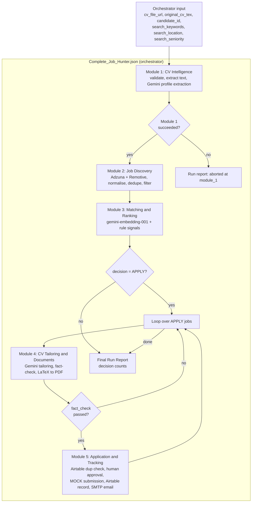

# AI Job Hunter

AI Job Hunter is a modular, AI-assisted job application pipeline built entirely in **n8n**. It takes a candidate CV, extracts a structured profile with Google Gemini, discovers jobs from Adzuna and Remotive, ranks them with a hybrid keyword and embedding score, tailors the CV and a cover letter for each strong match with a fact-check gate, compiles the tailored LaTeX CV to PDF, and asks a human to approve each application. It then records the application in Airtable and sends a confirmation email.

The repository contains the n8n workflow exports (one orchestrator and five modules) and a technical report. **The application submission step is mocked.** No application is ever sent to an employer.

## Key features

- **CV intake**: PDF or LaTeX (`.tex`) CVs from a remote URL or an n8n form upload. Files are validated by extension, size (10 MB limit) and content signature (`%PDF-` header, or `\documentclass` / `\begin{document}` for LaTeX). DOCX is explicitly rejected.
- **Text extraction with fallback**: native PDF text extraction. If it yields fewer than 50 characters, the PDF is sent to Gemini for transcription. LaTeX sources are stripped to plain text.
- **Structured profile extraction**: Gemini returns a JSON candidate profile (skills, languages, frameworks, tools, titles, education, experience years, and more). The profile is schema-validated, checked for placeholder values, and repaired with up to two re-prompts.
- **Multi-source job discovery**: Adzuna (3 pages of 50 results, country `gb`) and Remotive are queried in parallel, normalised to a common job schema, enriched by description mining (skills, years of experience, education and seniority), deduplicated (same company, title Jaccard similarity of 0.6 or more, matching or remote location) and quality-filtered.
- **Hybrid ranking**: `gemini-embedding-001` cosine similarity combined with rule-based signals, producing a score from 0 to 100, an explanation, and an `APPLY` / `REVIEW` / `REJECT` decision.
- **Fact-checked tailoring**: Gemini rewrites the summary, reorders skills and experience, and writes a cover letter. Code-node checks reject skills not in the original CV, any claimed "missing" skill, and placeholder company names. There is one regeneration attempt before a controlled failure.
- **PDF generation**: the tailored LaTeX is compiled with `pdflatex` through the public `latex.ytotech.com` build service, and the result is checked for a valid PDF header.
- **Human-in-the-loop**: an n8n Wait node shows an APPROVE / REJECT form before any submission, with a time limit.
- **Tracking and notification**: Airtable duplicate check (by `candidate_id` and `job_id`), an Airtable tracking record, and an SMTP confirmation email with the tailored PDF and cover letter attached.
- **Statistics**: a separate manual trigger in Module 5 counts tracking records by status.

## Architecture



Each module is a separate n8n workflow with an **Execute Workflow Trigger** (called by the orchestrator) and a **Manual Trigger** with built-in sample data for standalone testing. Module 1 also has a **Form Trigger** for uploading a CV directly.

## Workflow modules

### Module 1: CV Intelligence (`Module 1 - CV Intelligence.json`)

**Inputs:** `cv_file_url`, `candidate_id` (generated if missing), or a file uploaded through the form trigger.

1. Download the CV if a URL is given, then run **File Validation** on the extension (`pdf`, `tex`), size, and content signature.
2. **Route by File Type**:
   - **LaTeX**: strip commands and convert sections and items to plain text.
   - **PDF**: use the n8n *Extract From File* node. If the text is shorter than 50 characters, use the **Gemini PDF fallback** (inline PDF sent to `gemini-3.5-flash`).
3. **Sufficient Text?** requires at least 50 characters before calling the LLM.
4. **LLM Extract** (`gemini-3.5-flash`, `generateContent`) is prompted to extract only facts present in the CV and to return a fixed JSON schema.
5. **Parse and Validate** checks required fields, types, email format and placeholder values. Failures go to *Repair Attempt* and then *Repair Attempt 2*. After three failed attempts the module emits `SCHEMA_VALIDATION_FAILED`.

**Output:** `candidate_profile.json` fields (`schema_version`, `candidate_id`, `candidate_name`, `email`, `experience_years`, `job_titles`, `technical_skills`, `education`, ...), or a `status: failed` object with an error code.

### Module 2: Job Discovery (`Module 2 - Job Discovery.json`)

**Inputs:** `keywords` (default `["python developer"]`), `location`, `seniority`, `max_results` (default 50).

| Step | Detail |
|---|---|
| Build Adzuna Query | 3 pages, `results_per_page: 50`, country `gb` |
| HTTP Request: Adzuna | `https://api.adzuna.com/v1/api/jobs/{country}/search/{page}` (credential required) |
| Build Remotive Query | `search` = joined keywords, `limit` = `max_results` |
| HTTP Request: Remotive | `https://remotive.com/api/remote-jobs` (no credential) |
| Normalize Adzuna / Remotive | Map each source to a common job schema (`job_id`, `job_title`, `company`, `location`, `description`, `application_url`, `salary`, ...) and report source status `ok` / `unavailable` |
| Description Mining | Dictionary-based skill extraction, plus years-of-experience, education and seniority regexes |
| Deduplication | Same normalised company, title Jaccard similarity of 0.6 or more, and matching or remote location. The longer description is kept. |
| Quality Filtering | Drop jobs with an empty description, a missing title or company, or a non-HTTP(S) URL |

**Output:** `jobs` plus a `run_report` (dropped counts and reasons, per-source status).

### Module 3: Matching and Ranking (`Module 3 - Matching and Ranking.json`)

**Inputs:** `candidate_profile`, `jobs`, `method` (`hybrid` by default; `keyword` and `semantic` are also supported).

1. **Build Embedding Batch Request**: one text for the candidate and one per job.
2. **Get Batch Embeddings**: `gemini-embedding-001:batchEmbedContents`.
3. **Compute Hybrid Scores**: cosine similarity between the candidate and each job embedding. If the embedding response is unusable, a token-overlap proxy is used instead. This is combined with rule-based signals:

| Signal | Weight |
|---|---|
| Required-skill match (with synonyms such as js/javascript, postgres/postgresql, k8s/kubernetes) | 0.35 |
| Semantic similarity (embeddings) | 0.25 |
| Experience years vs. requirement | 0.15 |
| Preferred-skill match | 0.10 |
| Education requirement | 0.05 |
| Title match | 0.05 |
| Location (remote counts as a match) | 0.05 |

**Decision thresholds:** score of 75 or more is `APPLY`, 50 or more is `REVIEW`, anything lower is `REJECT`. Jobs are sorted by score and then by whether the experience requirement is met. Each result includes a `score_breakdown`, matched and missing skills, and a text explanation.

### Module 4: CV Tailoring and Documents (`Module 4 - CV Tailoring and Documents.json`)

**Inputs:** `candidate_id`, `candidate_email`, `original_cv_tex` (the candidate's LaTeX CV source), `selected_job`.

1. **LLM Tailor (Attempt 1)** (`gemini-3.5-flash`) returns `tailored_summary`, `tailored_skills_order`, `tailored_body_latex` and `cover_letter`, using only facts from the original CV.
2. **Parse and Fact-Check** flags invalid JSON, missing keys, skills not present in the original CV, any of the job's `missing_skills` claimed in the output, and placeholder company names.
3. On failure, it sends **one regeneration** with the error list. If that also fails, the module emits `UNSUPPORTED_CLAIMS`.
4. **Reassemble Tailored LaTeX** keeps the original preamble and adds a Summary section and the tailored body.
5. **Compile LaTeX to PDF** sends a `POST` to `https://latex.ytotech.com/builds/sync` with `pdflatex`. **Verify Compiled PDF** checks for a `%PDF-` header and a size above 500 bytes, then stores the PDF as a base64 data URL.
6. **Assemble application_package.json** builds the package (job fields, `cv_file`, `cv_tex_file`, `cover_letter_file`, `tailoring_meta`, `fact_check`, `latex_compiled`). **Create PDF Binary File** attaches the PDF as binary, and the workflow then calls Module 5.

### Module 5: Application and Tracking (`Module 5 - Application and Tracking.json`)

**Input:** `application_package`.

1. **Validate Package** checks the required fields and that `fact_check.passed` is `true`.
2. **Duplicate Check (Airtable)** queries the `APPLICATION` table with `filterByFormula` on `candidate_id` and `job_id`. A match emits `skipped_duplicate`.
3. **Wait for Human Approval** pauses on an n8n form with an `APPROVE` / `REJECT` dropdown and a wait limit of 24 (n8n's default unit for this setting is hours). Reject emits `NOT_APPROVED`, and a timeout emits `pending_approval`.
4. **Mock Submission** does **not** contact the employer or the `application_url`. It only checks that the URL is a valid HTTP(S) URL. An invalid URL emits `PERMANENT_SUBMISSION_FAILURE`.
5. **Persist Tracking Record (Airtable)** creates a record with `candidate_id`, `job_id`, `company`, `job_title`, `application_status` and `submitted_at`.
6. **Send Confirmation Email** (n8n *Send Email* node over SMTP) goes to `candidate_email`, with the tailored PDF (if compiled) and `cover_letter.txt` attached. An email failure still reports the application as `submitted`, with `confirmation_sent: false`.

A separate **Manual Trigger: Get Statistics** branch fetches all Airtable records and counts them by `application_status`. Its URL is a placeholder (`REPLACE_WITH_BASE_ID/REPLACE_WITH_TABLE_NAME`) and has no credential attached.

### Orchestrator (`Complete_Job_Hunter.json`)

**Inputs:** `cv_file_url`, `original_cv_tex`, `candidate_id`, `search_keywords`, `search_location`, `search_seniority`. If `original_cv_tex` or `search_keywords` are missing, sample defaults are used.

The orchestrator runs Module 1 and aborts with a run report if no profile was produced. It then runs Modules 2 and 3, counts the `APPLY` / `REVIEW` / `REJECT` decisions, and loops over `APPLY` jobs. Each loop iteration runs Module 4 and, if the fact check passed, Module 5. The final run report contains the decision counts. The outcome of each application is recorded in each sub-workflow's own execution log, not aggregated in the report.

## Tech stack

| Component | Used for |
|---|---|
| n8n | Workflow engine: Code (JavaScript), HTTP Request, Set, If, Switch, Merge, Loop, Wait, Form and Execute Workflow nodes |
| Google Gemini API (`gemini-3.5-flash`) | CV profile extraction, PDF text fallback, CV and cover-letter tailoring |
| Google Gemini API (`gemini-embedding-001`) | Candidate and job embeddings for semantic similarity |
| Adzuna API | Job search |
| Remotive API | Remote job search (public endpoint) |
| latex.ytotech.com | LaTeX to PDF compilation (`pdflatex`) |
| Airtable REST API | Duplicate detection and application tracking |
| SMTP | Confirmation email |

## Repository structure

```text
job-hunter-agent/
├── Complete_Job_Hunter.json                    # Orchestrator workflow
├── Module 1 - CV Intelligence.json
├── Module 2 - Job Discovery.json
├── Module 3 - Matching and Ranking.json
├── Module 4 - CV Tailoring and Documents.json
├── Module 5 - Application and Tracking.json
├── Job_Hunter_All_Modules_Report.docx          # Technical report: per-module design, problems and fixes
└── README.md
```

## Setup

### 1. Get the workflows

```bash
git clone https://github.com/Rewanooo22/job-hunter-agent.git
cd job-hunter-agent
```

You need an n8n instance, either n8n Cloud or self-hosted.

### 2. Import the workflows

In n8n, import each JSON file (**Workflows → Import from File**): the five `Module N - ....json` files first, then `Complete_Job_Hunter.json`.

### 3. Create credentials

The exports reference credentials by name only. No secret values are included. Create the following in n8n and assign them to the listed nodes:

| Credential type (n8n) | Purpose | Nodes |
|---|---|---|
| Custom Auth (`httpTemplatedCustomAuth`) for the Gemini API key | Authenticates calls to `generativelanguage.googleapis.com` | Module 1: *LLM Extract* (×3) and *Extract PDF Text via Gemini (Fallback)*. Module 3: *Get Batch Embeddings*. Module 4: *LLM Tailor (Attempt 1)* and *LLM Tailor (Retry)* |
| Custom Auth (`httpTemplatedCustomAuth`) for the Adzuna `app_id` / `app_key` | Authenticates Adzuna search requests | Module 2: *HTTP Request: Adzuna* |
| Custom Auth (`httpTemplatedCustomAuth`) for an Airtable personal access token | Authenticates Airtable REST calls | Module 5: *Duplicate Check (Airtable)*, *Persist Tracking Record (Airtable)*, *Fetch All Tracking Records* |
| SMTP | Sends the confirmation email | Module 5: *Send Confirmation Email* |

Remotive and latex.ytotech.com are called without credentials.

In the export, *LLM Tailor (Retry)* in Module 4 references a different credential slot than *LLM Tailor (Attempt 1)*. Make sure it uses your Gemini credential.

### 4. Replace instance-specific values

- **Airtable base and table**: the Airtable URLs in Module 5 contain the original author's base ID. Replace it with your own base ID and table in *Duplicate Check (Airtable)* and *Persist Tracking Record (Airtable)*, and fill in the `REPLACE_WITH_BASE_ID` / `REPLACE_WITH_TABLE_NAME` placeholders in *Fetch All Tracking Records*. The table needs the fields `candidate_id`, `job_id`, `company`, `job_title`, `application_status` and `submitted_at`.
- **Persist Tracking Record URL**: in the export, this URL has a stray non-ASCII character before `https://`. Remove it, or the request fails. The node is set to continue on error, so the failure is easy to miss.
- **Sender email**: set the *From* address in *Send Confirmation Email* to an address your SMTP account can send from. The recipient is taken from `candidate_email`.
- **Adzuna country**: *Build Adzuna Query* hard-codes `country: "gb"`. Change it if you want another market.

### 5. Re-link the sub-workflows

n8n assigns new workflow IDs on import. Open each **Execute Workflow** node and select the matching imported module:

- In `Complete_Job_Hunter.json`: *Execute Workflow -> Module 1* through *Module 5*.
- In Module 4: *Call 'Module 5 - Application and Tracking'*.

### 6. Run

- **Single module:** open a module and run its Manual Trigger. Each one has built-in sample data. Module 1 needs a real file, so use its Form Trigger to upload a PDF or `.tex` CV.
- **End to end:** run `Complete_Job_Hunter.json` with `cv_file_url` (a reachable PDF or `.tex` CV) and `original_cv_tex` (the LaTeX source used for tailoring), plus optional `search_keywords`, `search_location` and `search_seniority`. When Module 5 reaches the approval step, open the Wait node's form from the execution and choose APPROVE or REJECT.

## Project status and limitations

- **The submission is mocked.** Module 5's *Mock Submission* only validates the application URL. No data is sent to employers or job boards.
- **Tailoring needs LaTeX source.** Module 4 tailors `original_cv_tex`, which the orchestrator receives separately from the CV file used in Module 1. If it is not provided, a sample LaTeX snippet is used.
- **Gating is partial.** The orchestrator explicitly checks only Module 1 (profile produced) and Module 4 (fact check passed). Module 2 and Module 3 results are not checked by a separate gate.
- **Module 5 may be called twice per job.** Module 4 calls Module 5 itself at the end, and the orchestrator also calls Module 5 after Module 4. Review this wiring before an end-to-end run, for example by removing one of the two calls, to avoid duplicate approval requests.
- **PDF failures stop the branch.** If LaTeX compilation fails, *Create PDF Binary File* throws an error.
- **Fact-checking is heuristic.** It uses string checks (skills present in the original CV, no claimed missing skills, placeholder names). It is not a full semantic verification.
- **Model names are as exported.** The Gemini model identifiers are hard-coded in the HTTP Request URLs and may need updating to models available on your account.
- **No results are committed.** The repository has no committed run outputs, metrics or screenshots.

## Security

- Keep all keys in n8n credentials. Never paste them into Code, Set or HTTP Request node parameters.
- Before re-exporting or sharing workflows, check HTTP Request URLs, headers, query parameters and email fields for personal identifiers (base IDs, addresses, CV data).
- Comply with the terms of service of every API you connect. Only enable real automated submission for platforms that explicitly allow it.

## Future improvements (ideas)

- Real submission integrations for platforms that permit automated applications.
- Consolidate the Module 4 to Module 5 call path, and add explicit success gates after Modules 2 and 3.
- Aggregate per-application outcomes into the final run report.
- DOCX CV support (currently rejected in Module 1).
- Additional job sources, and configurable country and location scoring.
